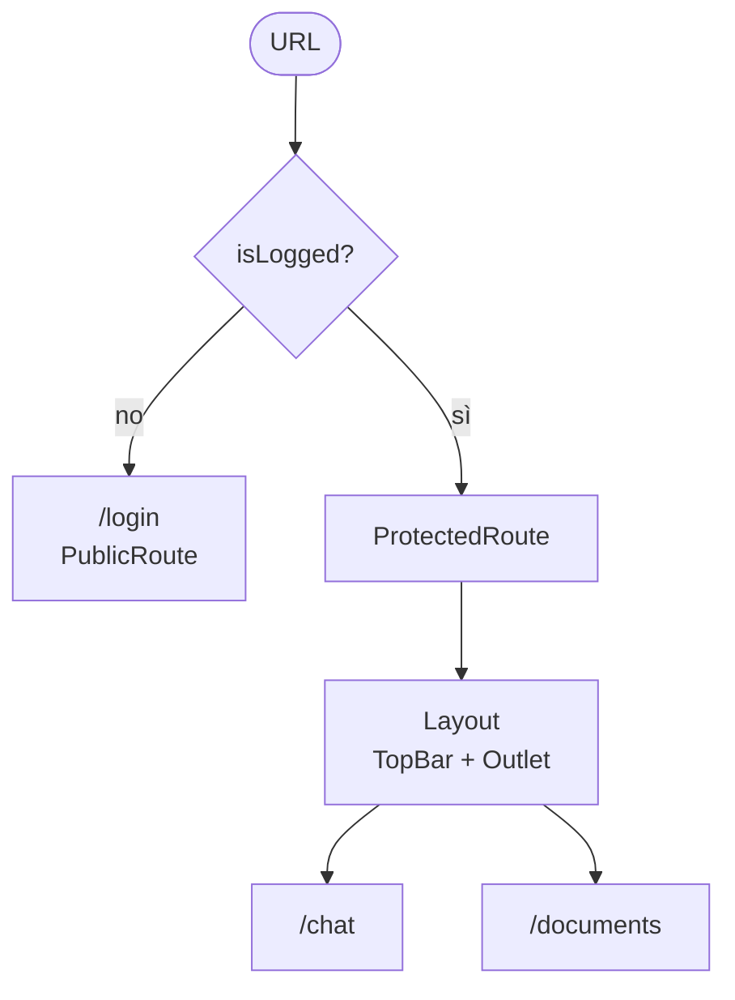

# 🍕 Margherita — Frontend

**Indice**
[Avvio](#-avvio) · [Scelte tecniche](#-scelte-tecniche) · [Struttura del progetto](#-struttura-del-progetto) · [Docker](#-docker) · [Possibili miglioramenti](#-possibili-miglioramenti)

---

## 🚀 Avvio

```bash
cd frontend_margherita
docker compose up --build -d   # http://localhost:8080
```

---

## 🧭 Scelte tecniche

### ⚡ Vite

Scelto per la **velocità**.

- **In sviluppo** il server parte subito, perché i moduli non vengono impacchettati in anticipo: il browser li carica solo quando servono.
- **Durante la modifica** l'hot reload aggiorna solo il modulo cambiato, senza ricaricare la pagina e senza perdere lo stato.
- **In produzione** genera file ottimizzati e con l'hash nel nome, quindi il browser può tenerli in cache a lungo.

### 🟦 TypeScript + React Compiler

**TypeScript** è un requisito del progetto. Porta anche vantaggi concreti:

- i tipi raccolti in `types.ts` descrivono i dati che girano nell'app e fanno da documentazione;

**React Compiler** ottimizza i componenti **in fase di build**

### 🧭 react-router-dom

È la libreria di routing più usata e più documentata dell'ecosistema React.

- Tutte le rotte sono definite **in un solo file**, `routes.ts`.
- Le **rotte annidate** con `<Outlet />` permettono di avere un layout fisso, con la top bar, e cambiare solo il contenuto della pagina.
- Le rotte **protette** e **pubbliche** sono semplici componenti che decidono se mostrare la pagina o reindirizzare con `<Navigate />`.

<details>
<summary>Come sono organizzate le rotte</summary>



| Componente       | Cosa fa                                                         |
| ---------------- | --------------------------------------------------------------- |
| `PublicRoute`    | se sei loggato, `/login` ti porta su `/chat`                    |
| `ProtectedRoute` | se non sei loggato, le pagine protette ti portano su `/login`   |
| `AuthRedirect`   | ogni altra rotta porta su `/chat` o `/login` in base allo stato |
| `Layout`         | tiene fissa la `TopBar` e mostra la pagina con `<Outlet />`     |

</details>

### 🗃 Stato globale con AppContainer (Context API) invece di Redux

Lo stato globale è gestito da `AppContainer` (`utilities/Container.tsx`) con la **Context API** di React, senza librerie esterne.

- **Lo stato condiviso è poco**: il flag `isLogged` e il popup di notifica. Una libreria dedicata sarebbe sovradimensionata.
- **L'accesso è semplice**: i componenti leggono lo stato con dei custom hook (`useAuth`, `usePopup`) e non sanno come è implementato.

<details>
<summary>Perchè non redux?</summary>

La scelta è adatta a un progetto piccolo come questo. Se l'app cresce, conviene passare a **Redux Toolkit** per una gestione centralizzata:

- **più stato condiviso tra molte pagine** → uno store unico e aggiornamenti prevedibili;

</details>

<details>
<summary>Perché <code>isLogged</code> è salvato anche in localStorage?</summary>

Lo stato globale vive **in memoria**: con un refresh della pagina si azzera e `isLogged` tornerebbe `false`, rimandando alla login anche un utente ancora autenticato.

- **Lo stato globale** serve a far aggiornare subito l'interfaccia quando `isLogged` cambia.
- **localStorage** serve a ricordare il valore dopo un refresh: all'avvio lo stato globale parte da lì.

</details>

### 📄 react-pdf

Usato per **visualizzare i PDF** direttamente nella pagina, senza aprire nuove schede.

- Permette di aprire il documento **alla pagina citata**.
- Permette di **evidenziare** le parti del testo a cui si riferisce la risposta.

### 💬 Special word: più messaggi in una sola chat

Le API salvano ogni domanda con la sua risposta come un messaggio a sé, senza sapere a quale chat appartiene. Per raggruppare più messaggi nella stessa chat usiamo una **special word**:

- ogni nuova chat genera una parola unica che termina con `_special_word`;
- la parola viene aggiunta all'inizio di ogni messaggio inviato in quella chat;
- quando si caricano i messaggi, quelli con la stessa parola vengono raggruppati nella stessa chat;
- la parola non viene mai mostrata all'utente.

<details>
<summary>Esempio</summary>

```text
Messaggio scritto:   Ciao!
Messaggio inviato:   3f9a…c21_special_word Ciao!
Messaggio mostrato:  Ciao!
```

</details>

---

## 🗂 Struttura del progetto

```text
frontend/src/
├── components/
│   ├── atoms/
│   └── molecules/
├── hooks/
├── i18n/
├── pages/
├── utilities/
├── types.ts
└── constants.ts
```

| Cartella / file        | Contenuto                                                                                                                          |
| ---------------------- | ---------------------------------------------------------------------------------------------------------------------------------- |
| `components/atoms`     | Componenti **semplici**, non scomponibili in parti più piccole. Es. `Button`, `Input`                                              |
| `components/molecules` | Componenti **assemblati** da più elementi, che possono contenere anche degli atoms. Es. `ChatCard`, `TopBar`, `Popup`              |
| `hooks`                | **Custom hook** riutilizzabili. Es. `useApi`, `useAuth`                                                                            |
| `i18n`                 | **Traduzioni**: un dizionario per lingua (`it.json`, `en.json`). La lingua viene scelta da quella del browser                      |
| `pages`                | Le **pagine** che compongono la web app, una per rotta. Es. `Login`, `Chat`, `Documents`                                           |
| `utilities`            | Le **funzionalità di supporto**: wrapper per le chiamate HTTP, stato globale, protezione delle rotte, layout e funzioni di utilità |
| `types.ts`             | Tutti i **tipi** riutilizzabili, comprese le props dei componenti                                                                  |
| `constants.ts`         | Tutte le **costanti** riutilizzabili                                                                                               |

<details>
<summary>🧱 Come è fatto un componente o una pagina</summary>

Ogni componente e ogni pagina ha una cartella con il suo nome e dentro due file:

```text
ChatCard/
├── index.tsx   # tutto il codice
└── index.css   # tutto lo stile, importato in index.tsx
```

</details>

### 🪝 Custom hooks

#### `useAuth`

Gestisce lo stato di login.

- `isLogged`: dice se l'utente è loggato.
- `login()`: lo mette a `true`, solo quando il login va a buon fine.
- `unauthorized()`: lo mette a `false`, quando una chiamata restituisce **401**.
- `logout()`: lo mette a `false`, quando l'utente clicca su logout.

#### `useApi`

Espone le funzioni per le chiamate HTTP: `GET`, `POST` e `POST_STREAM` (per le risposte in streaming della chat).

- Gli errori arrivano già con un **messaggio tradotto**, pronto da mostrare nel popup.
- Se una chiamata restituisce **401**, l'utente viene **sloggato in automatico** con `unauthorized()` e rimandato alla login.

---

## 🐳 Docker

| File                  | Contenuto                                                                                                                                                                              |
| --------------------- | -------------------------------------------------------------------------------------------------------------------------------------------------------------------------------------- |
| `frontend/Dockerfile` | Crea l'immagine dell'app in due fasi: **Node** compila il progetto, **nginx** serve solo i file statici generati. L'immagine finale è leggera e non contiene né Node né `node_modules` |
| `docker-compose.yml`  | Avvia il frontend con un solo comando, sulla porta `8080`, e permette di configurare l'URL delle API                                                                                   |
| `frontend/nginx.conf` | Fa ricadere tutte le rotte su `index.html`, così `/chat` e `/documents` funzionano anche dopo un refresh. Tiene in cache gli asset                                                     |

<details>
<summary>Cambiare l'URL delle API</summary>

```bash
VITE_BASE_URL=http://altro-host:8000/api docker compose up --build -d
```

L'URL viene scritto nei file dell'app **in fase di build**: dopo averlo cambiato serve `--build`, non basta riavviare il container.

</details>

---

## 🔧 Possibili miglioramenti

### DTO per le risposte delle API

Oggi i tipi in `types.ts` (es. `ChatRecord`, `DocumentItem`) ricalcano esattamente il JSON delle API e vengono usati direttamente nei componenti. Si potrebbero separare in due livelli:

- **DTO** (`ChatRecordDto`, …): descrivono il JSON così come arriva, con i suoi nomi (`created_at`, `page_count`, …);

### Test

Il progetto non ha ancora test. Non sarebbe male aggiungerli, anche **React Testing Library** potrebbe essere aggiunto un domani per la documentazione dei componenti (in questo progetto non mi sembrava il caso di aggiungerlo).
